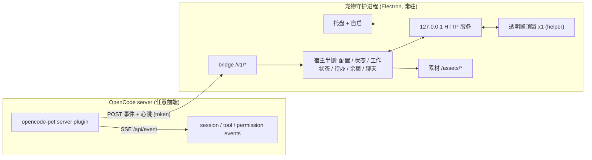

# 设计基线：常驻桌面宠物

- 日期：2026-11-11（v1 实现前写下的设计基线）
- 状态：v1 已按此实现并验收；**实现中偏离的地方集中列在文末「实现与设计的差异」**
- 来源：把 `PC2005-cloud/dsh-pet`（MIT / 素材 CC BY-NC-SA 4.0）移植到 OpenCode 生态
- 目标平台：macOS 优先（arm64 + x64），代码保留 Windows/Linux 路径

> 读这份文档的方式：第 1–5 节的**判断与取舍**仍然成立（为什么是独立进程、为什么不用 Tauri、
> 为什么 fork standalone 模式）；第 6 节之后的**接口细节**以代码为准，差异见文末。

---

## 1. 意图与为什么

用户要的是**一只**桌面宠物：常驻在操作系统桌面上，用桌面 app、浏览器、终端时都能看见它；不是每个 OpenCode 窗口里各画一只。

因此宠物的生命周期不能绑在 OpenCode 的某个客户端上：

- OpenCode 有 TUI、桌面 app、Web 三种前端，还有多窗口；
- 在每个前端里渲染会导致“多只宠物”、状态不同步、位置不同；
- 用户明确选择了「桌面常驻、同一只」。

最终形态：**一个独立常驻的宠物守护进程**，拥有唯一的宠物实例和唯一的透明置顶窗；OpenCode 只是一个“事件源”，把会话状态推给它。OpenCode 没开时，宠物仍然待机、可拖拽、可玩、可看本地待办。

---

## 2. 目标 / 非目标 / 反目标

### 目标

1. macOS 上常驻：开机自启、单实例、托盘可退出、崩溃可恢复。
2. 唯一一只宠物：一个进程、一个窗口、一个状态实例。
3. 透明、置顶、点击穿透、多屏、拖拽甩抛、动画链、气泡、右键菜单、睡眠、待办，全部复用 dsh-pet 已实现的行为。
4. 跟随 OpenCode 会话：思考 / 工作 / 整理 / 等待 / 成功 / 出错六档工作状态，完成/出错气泡。
5. 与 OpenCode 解耦：OpenCode 启动、退出、重启都不影响宠物进程；连接断开后 15 秒内回到空闲。
6. 素材本地服务：不依赖外网、不给 OpenCode 加静态资源路由。
7. 个人非商业使用；保留 dsh-pet 署名与授权。

### 非目标（v1 不做）

- 在 OpenCode 的桌面/网页窗口内渲染宠物（GUI plugin overlay）。
- TUI 内渲染 ASCII 宠物。
- 多宠物 / 多开。
- Windows / Linux 的正式打包（代码保留，v1 只在 macOS 验证）。
- 通过 OpenCode 的模型/凭据做聊天；v1 聊天与余额沿用 dsh-pet 独立模式的 AI 配置。
- 点击气泡跳转到 OpenCode 会话（后续可用深链）。
- 远程 server 场景（宠物运行在本机；连远端 OpenCode 不在 v1 范围）。

### 反目标（即使能跑也算失败）

- 同时出现两只或以上宠物。
- 宠物必须依赖 OpenCode 进程才能启动或存活。
- 为了宠物去 fork OpenCode 内核。
- 素材要联网才能播放。
- 安装后需要用户手动跑一堆命令才能常驻。

---

## 3. 约束

- **素材**：dsh-pet 的 webm 透明视频依赖 Chromium 的 VP9-alpha；WKWebView/Safari 会变黑底。因此窗口必须用 Electron/Chromium，不能用系统 WebView。
- **授权**：代码 MIT；动画/提示词/源视频 CC BY-NC-SA 4.0，角色为社区二创。个人非商业可用；公开发布需署名原作者仓库、非商业、相同方式共享；不得并入 OpenCode 官方发行版。
- **OpenCode 版本**：**目标 2.2.7**（2026-11-10 发布）。本机当前是 2.1.3，开工第一步先升级并验证插件 API（`@opencode/plugin`、`ctx.event.subscribe`、`plugins` 配置）。设计按 2.2.7 写；事件流仍是实验性的，字段可能变。
- **现有资产**：dsh-pet 的独立应用模式（`src/app/main.ts`）已经做到「一个 Electron 进程 = 本机 HTTP 服务 + 宿主半侧 + 透明窗」，本项目以它为起点，不重写窗口层。
- **个人环境**：macOS，无 Apple 开发者签名时接受 Gatekeeper 首次提示。

---

## 4. 方案选择

| 方案                         | 说明                                                                                                               | 结论                                                                             |
| ---------------------------- | ------------------------------------------------------------------------------------------------------------------ | -------------------------------------------------------------------------------- |
| **1. 独立守护进程（选用）**  | fork dsh-pet 的 standalone/app 模式：常驻 Electron 进程自带窗口、托盘、素材服务、配置与状态；OpenCode 插件只推事件 | **选用**：真正常驻；素材问题顺手解决；不改 OpenCode 内核；终端/浏览器/桌面都成立 |
| 2. OpenCode desktop 内置窗口 | 在桌面版里加透明窗与后台常驻                                                                                       | 否决：要 fork 内核；opencode 退出宠物就没了，与“常驻”冲突；纯 CLI 用户用不上     |
| 3. 原生小窗（Tauri/Swift）   | 不用 Electron，做轻量透明窗                                                                                        | 否决：macOS WKWebView 不支持 webm alpha，得换 HEVC `.mov` 素材并重做渲染层       |

方案 1 的关键发现：dsh-pet 已经有完整实现——

- `src/app/main.ts`：单进程独立应用（本机 HTTP + `apply()` 宿主半侧 + 同进程 require helper）。
- `src/standalone/*`：伪 Cordis ctx，把 DSH 插件跑在 DSH 之外；已有 AI 配置页、余额、`runtime.json`、令牌校验。
- `runtime/electron-helper/*`：透明/置顶/点击穿透/多屏/托盘/DPI/看门狗，全部现成。
- `src/host/*`：会话事件 → 工作状态/通知，配置、待办、余额、语音、聊天记忆。

本项目的增量是：**替换事件源、改数据目录、加开机自启与桥接口**。

---

## 5. 总体架构



数据流：

1. OpenCode 插件订阅事件，归一化后批量 POST 给守护进程。
2. 守护进程把 OpenCode 事件翻译成 dsh-pet 内部已有的 DSH 事件形状，喂给现有 reducer。
3. reducer 更新 `/state` 叶子，窗口长轮询后播放动画/气泡。
4. 窗口的拖拽、菜单、位置等仍走原有本机 HTTP 路由。
5. 心跳超时 → 工作状态回空闲，宠物继续待机。

---

## 6. 组件设计

### 6.1 宠物守护进程（`opencode-pet` app）

以 dsh-pet 的 `src/app/main.ts` 为骨架 fork：

- **进程模型**：单个 Electron 进程；主进程内 `require('runtime/electron-helper/main.js')`（与 dsh-pet app 模式一致）。
- **本机服务**：`node:http` 仅监听 `127.0.0.1:0`，随机端口；启动完成后写运行时文件。
- **路由**：沿用 dsh-pet 的 `/dsh-pet-7340/*`（迁移期保留），新增桥接口 `/opencode-pet/bridge/v1/*`。
- **宿主半侧**：直接复用 `apply(ctx)`；伪 ctx 从 `createStandaloneContext` 扩展。
- **窗口**：复用 helper，每只宠物一个窗口；v1 固定 1 只。
- **配置**：`~/.opencode-pet/config.jsonc`（沿用 dsh-pet 的 JSONC 结构，`pets` 只允许 1 项）。
- **数据**：`~/.opencode-pet/` 下放 config、todos、chat memory、logs、avatars、runtime.json。
- **AI**：沿用 `standalone/ai-provider` 与设置页，聊天/余额在 OpenCode 未运行时也可用。
- **日志**：`~/.opencode-pet/logs/pet.log`，单文件 5MB 轮转，token 永不落日志。

改动点（相对 dsh-pet）：

1. 数据目录 `dshHomeDir()` → `opencodePetHome()`，默认 `~/.opencode-pet`，支持 `OPENCODE_PET_HOME`。
2. 环境变量前缀 `DSH_PET_*` → `OPENCODE_PET_*`（保留旧名兼容一版）。
3. 应用名 / appId / userData / 托盘名 / 图标。
4. `createStandaloneContext.on()` 从空实现改成真正的事件发射器。
5. 新增桥路由与运行时文件写入（app 模式目前未写 runtime 文件）。
6. 新增开机自启管理。
7. 设置页增加「OpenCode 联动状态」：未连接 / 已连接 / 最近事件时间 / 版本。
8. 关闭 dsh-pet 的 web 可见性、DSH 专属命令、DSH 深链。

### 6.2 OpenCode 桥接插件（`opencode-pet` npm 包的 `./server`）

一个普通 server plugin（`@opencode/plugin`，Promise 或 Effect 均可），约 300–500 行：

- `Plugin.define({ id: 'opencode-pet', setup })`。
- 启动时读取 `~/.opencode-pet/runtime.json`；不存在则每 5 秒重试（最多 60 秒后降为 30 秒）。
- 订阅 `ctx.event.subscribe()`。
- 事件归一化 + 100ms 批量 + 2s 超时 POST。
- 每 5 秒发心跳（含 server 版本、活跃会话数、会话标题增量）。
- 连续 3 次失败 → 重新读 runtime 文件（守护进程可能重启、端口/令牌变化）。
- 卸载时发 `bye`。
- 插件选项：`{ home?: string, enabled?: boolean, autoStart?: boolean }`；`autoStart` 为 true 时在守护进程未运行时尝试 `open -a "OpenCode Pet"`（macOS），失败只记日志。
- **不阻塞 OpenCode**：所有网络调用异步、失败静默、丢弃过期事件（volatile）。

安装方式（v1 定为手动一行 + 引导）：

- OpenCode 配置里加 `"plugins": ["opencode-pet"]`（或本地目录）即可。
- 宠物设置页提供「安装 OpenCode 联动」区域：显示当前配置路径、复制现成 JSON 片段、检测插件是否已加载（通过 `hello` 是否到达）。
- **v1 不自动改用户配置**：`opencode.json` 是用户的文件，自动合并有备份/回滚/多 profile 风险；一行配置不属于“一堆命令”。若后续确认要自动安装，再单独加安全合并组件。

### 6.3 协议

#### 运行时发现

`~/.opencode-pet/runtime.json`（0600，原子写）：

```json
{
  "name": "opencode-pet",
  "version": "0.1.0",
  "pid": 12345,
  "port": 53421,
  "token": "<32-byte hex>",
  "startedAt": "2026-11-11T08:00:00.000Z"
}
```

- 每次启动生成新 token，退出时删除（只删 pid+token 匹配的文件）。
- 插件只读此文件，不扫描端口。

#### 桥接口

`POST /opencode-pet/bridge/v1/hello`
`POST /opencode-pet/bridge/v1/events`
`POST /opencode-pet/bridge/v1/bye`

Headers：`Authorization: Bearer <token>`、`Content-Type: application/json`。
限制：body ≤ 256KB，1000 事件/分钟，事件 `id` 去重（保留最近 1000 个）。
拒绝带 `Origin` 头的请求（浏览器页面不得调用桥接口）。

`events` 请求体：

```json
{
  "protocol": 1,
  "pluginVersion": "0.1.0",
  "server": { "version": "2.2.7", "url": "http://127.0.0.1:4096" },
  "sentAt": 1762848000000,
  "events": [
    {
      "id": "evt_123",
      "type": "session.tool.called",
      "sessionID": "ses_abc",
      "sessionTitle": "修复登录",
      "parentID": null,
      "at": 1762848000000,
      "data": { "tool": "bash", "callID": "call_1", "title": "bun test" }
    }
  ]
}
```

归一化原则：只带宠物需要的字段；不传完整消息体，避免大 payload。

### 6.4 事件映射（OpenCode → dsh-pet 内部 DSH 形状）

dsh-pet 的 reducer 已认这些类型：`turn/start`、`turn/end`、`tool/call`、`tool/result`、`approval/asked`、`question/requested`、`assistant/message`、`agent/error`、`todo/write`。

| OpenCode 事件                                            | 映射为                             | 工作状态         | 说明                              |
| -------------------------------------------------------- | ---------------------------------- | ---------------- | --------------------------------- |
| `session.execution.started`                              | `turn/start`                       | thinking         | 新 turn                           |
| `session.thinking.started` / `session.reasoning.started` | `turn/start`                       | thinking         | 仅首次                            |
| `session.tool.called` / `session.tool.input.started`     | `tool/call`                        | working          | 气泡任务 = 工具标题               |
| `session.tool.success`                                   | `tool/result`                      | result           | 若还有在途调用则保持 working      |
| `session.tool.failed`                                    | `tool/result`                      | result           | 记录错误，turn 结束时可能转 error |
| `permission.asked` / `form.created`                      | `approval/asked`                   | waiting          | 气泡“等待确认”                    |
| `form.replied` / `permission.replied`                    | `approval/replied`（新增内部事件） | working          | 回到工作                          |
| `session.execution.succeeded`                            | `turn/end` (completed)             | success          | 完成气泡                          |
| `session.execution.failed`                               | `turn/end` (error)                 | error            | 错误气泡                          |
| `session.execution.interrupted`                          | `turn/end` (aborted)               | idle             | 不庆祝                            |
| `session.idle`                                           | `turn/end` (idle)                  | idle             | 兜底                              |
| `session.text.ended`                                     | `assistant/message`                | —                | 最近回复文本，供气泡/通知         |
| `session.created` / `session.renamed`                    | 会话元数据                         | —                | 标题映射，通知用                  |
| `session.compaction.started` / `.ended`                  | `tool/call` / `tool/result`        | working / result | 可选                              |

补充规则：

- `parentID != null` 视为子代理：只更新状态，不弹完成通知（对齐 dsh-pet 的 `shouldNotifySession`）。
- 同一 `sessionID` 的在途工具表沿用 dsh-pet 的 `ToolCallLedger`，结果回来才清。
- 空闲判定：`session.idle` 或心跳超时 15s。

### 6.5 窗口与渲染

- 完全复用 `runtime/electron-helper`：`BrowserWindow({ transparent, frame:false, alwaysOnTop, skipTaskbar, hasShadow:false })` + `setIgnoreMouseEvents(true, { forward:true })` 的命中区翻转。
- 渲染端 `renderer.js` + `sprite/*` 是 vanilla JS，不依赖 React；素材通过本机 HTTP `/assets/webm/*` 播放。
- 窗口位置、多屏、DPI、置顶看门狗、任务栏看门狗、托盘全部沿用。
- v1 固定 1 只宠物；`config.pets` 超过 1 项时只取第一项并告警。

### 6.6 开机自启与崩溃恢复

macOS 统一由 launchd 托管，避免“双击启动的实例不受 KeepAlive 监管”这个坑：

- `~/Library/LaunchAgents/com.opencode.pet.plist`
- `RunAtLoad=true`，`KeepAlive={ SuccessfulExit:false }`，`ThrottleInterval=10`
- `ProgramArguments = [<app>/Contents/MacOS/OpenCode Pet, --launchd]`

启动规则：

1. 首次运行写 plist，并 `launchctl bootstrap gui/$UID <plist>` + `kickstart`，然后当前进程退出；之后屏幕上看到的是 launchd 托管的实例。
2. 用户双击 `.app`：检测 `--launchd` 参数与环境；不是 launchd 启动的，就走第 1 步委托，不直接建窗口。因此**所有实例都在 launchd 下，杀进程 10 秒内会被拉起**。
3. 托盘「退出」：设置一次性 `quit` 标记后 `app.exit(0)`；`SuccessfulExit:false` 不会重启；下次登录或手动启动再回来。
4. 托盘「开机启动」：勾选 = plist 存在且已 bootstrap；取消 = `bootout` 并删 plist。

其它平台留接口：

- Windows：`HKCU\Software\Microsoft\Windows\CurrentVersion\Run`，配一个轻量 supervisor（v1 不验证）
- Linux：`~/.config/autostart/opencode-pet.desktop`

### 6.7 安全

- HTTP 只绑 `127.0.0.1`。
- 桥接口 Bearer token，token 0600、每次启动轮换、绝不写日志。
- 渲染端请求继续用 dsh-pet 的 `installDesktopAuth`（file:// 顶层 frame + 目标 origin + 路由前缀才注入）。
- body 限长、JSON 校验、事件去重、限速。
- 拒绝浏览器 Origin；防止任意网页探测本机宠物 API。
- 设置页沿用 `#token=` 片段传令牌，不进日志、不进 Referer。

---

## 7. 生命周期与时序

### 守护进程启动

1. 单实例锁（`requestSingleInstanceLock`），失败则聚焦已有实例并退出。
2. 初始化日志、配置、AI、伪 ctx、宿主半侧。
3. 起本机 HTTP（随机端口），拿 `port`。
4. 生成 token，原子写 `runtime.json`。
5. `require` helper 主进程（必须在 `app.ready` 前装载其 `commandLine` 开关）。
6. helper 建透明窗；宿主半侧按配置落位。
7. 托盘出现；写 LaunchAgent（若开启自启）。
8. 进入空闲状态，等待桥事件或本地交互。

### OpenCode 启动

1. 插件 setup 读 `runtime.json`。
2. `hello` → 守护进程记录连接、会话标题快照。
3. `events` 流开始；心跳 5s。
4. 宠物切到对应工作状态。

### OpenCode 退出 / 插件卸载

1. 插件发 `bye`（尽力而为）。
2. 守护进程 15s 无心跳 → `workStatus = null`、清空气泡、回到待机。
3. 宠物进程与窗口不受影响。

### 守护进程退出

- 托盘「退出」→ 释放路由、停 helper、删 `runtime.json`、`app.exit(0)`。
- 崩溃 → LaunchAgent `KeepAlive` 在 10s 后重启；新 token/端口，插件下次失败重读 runtime 文件。
- OpenCode 不会因为宠物退出而受影响。

### 端口/令牌变化

插件连续 3 次请求失败 → 重读 `runtime.json`；若 pid 变化或文件消失 → 进入重试循环，不刷日志。

---

## 8. 错误处理与降级

| 故障                  | 表现          | 处理                                                       |
| --------------------- | ------------- | ---------------------------------------------------------- |
| 守护进程未启动        | 宠物不存在    | 插件静默重试；`autoStart` 开启时尝试启动一次               |
| runtime 文件缺失/过期 | 插件无法连接  | 重试 + 指数退避；校验 pid 存活                             |
| 桥请求失败            | 状态不同步    | 丢弃本批事件（volatile），下次心跳恢复；不阻塞 OpenCode    |
| 事件字段变化          | 未知事件      | 记 debug 日志并忽略；已识别事件继续                        |
| helper 崩溃           | 窗口消失      | 主进程重启 helper；连续失败则托盘提示                      |
| 素材缺失              | 视频黑屏/不播 | 启动自检（dsh-pet 已有 smoke check），托盘提示并回退静态图 |
| 端口被占用            | 启动失败      | 随机端口，不固定；失败重试 3 次后报错                      |
| 显示器变化            | 位置错乱      | 沿用 helper 的 displays 同步                               |
| 配置写坏              | 启动失败      | 备份损坏文件 + 回退内置默认（沿用 dsh-pet）                |

---

## 9. 打包与分发

- `electron-builder`，macOS：`target: [dmg, zip]`，`arch: [arm64, x64]`，`LSUIElement: true`（无 Dock 图标），`asar: true`。
- 素材只带运行所需：`assets/webm`、`fonts`、`pic`、`memes`、`sound`、`config.jsonc`、`logo.png`；排除 `assets/preview`（69MB GIF）。
- 个人使用：`identity: null` 做 ad-hoc 签名；文档写明首次打开需右键打开 / `xattr -dr com.apple.quarantine`。
- 版本两处：app 版本与插件版本独立；桥协议 `protocol: 1` 兼容。
- 插件以**本地目录**交付（构建产物 `dist/server.js` + `package.json` + `README`），不发布 npm；安装到 OpenCode 的插件目录，或在 `plugins` 配置里写本地路径（实施时以 2.2.7 的实际解析规则为准）。
- 交付物：
  - `OpenCode Pet.app`（守护进程）
  - `opencode-pet/` 本地插件目录（OpenCode 插件）

---

## 10. 测试策略

### 单元测试

- 事件映射：每种 OpenCode 事件 → 内部事件/工作状态；子代理过滤；未知事件忽略。
- 去重与限速；body 限长。
- runtime 文件读写、token 轮换、过期校验。
- 自启 plist 生成/删除（纯字符串，不真写）。
- 配置迁移与单宠物约束。

### 集成测试

- 不起 Electron，用 dsh-pet 已有的 standalone 路由测试台：
  - 起 HTTP + 伪 ctx + 宿主半侧；
  - POST `hello`/`events`；
  - 轮询 `/state` 断言六档状态与气泡；
  - 心跳超时后回到空闲。
- 桥接口鉴权：无 token、错 token、带 Origin、超大 body。

### 手工验收（macOS）

**必须通过（v1 验收线）**

1. 双击启动 → 只有一只宠物，透明、置顶、可穿透。
2. 拖拽、甩抛、双击弹弓、右键菜单、睡眠、待办。
3. 启动 OpenCode 跑一个会调工具的会话 → 宠物切思考/工作/整理/成功。
4. 关掉 OpenCode → 15s 内回空闲。
5. 重启 OpenCode → 自动重连。
6. 托盘退出 → 无残留进程；杀掉宠物 → 10s 内自启恢复；重启系统 → 自动出现。
7. 多屏、缩放切换 → 位置正确。

**保留但不作为验收阻塞**：聊天、余额、TTS/STT、表情包、点击音效、头像/图片附件。它们沿用 dsh-pet 独立模式，坏了不影响宠物主体；对应设置项必须能明确显示“不可用/未配置”，不能留死按钮。

---

## 11. 里程碑（估算 2 周，1 人）

| 里程碑 | 内容                                                                                                        | 估时     |
| ------ | ----------------------------------------------------------------------------------------------------------- | -------- |
| M0     | 升级 OpenCode 2.1.3 → 2.2.7；最小探针插件验证 `@opencode/plugin` / `ctx.event.subscribe` / 本地插件目录加载 | 0.5–1 天 |
| M1     | fork + 改名 + 数据目录 + 在 macOS 跑通独立 app（透明窗/托盘/素材）                                          | 2 天     |
| M2     | runtime 文件 + 桥路由 + 鉴权 + 插件骨架（hello/heartbeat/bye）                                              | 3 天     |
| M3     | 事件映射 + 工作状态 + 气泡 + 心跳超时                                                                       | 3 天     |
| M4     | 开机自启 + 单实例 + 日志轮转 + 托盘状态                                                                     | 2 天     |
| M5     | 打包（dmg/zip）+ 文档 + 署名/NOTICE                                                                         | 2 天     |
| M6     | 集成测试 + 真机验收 + 修复                                                                                  | 2 天     |

---

## 12. 风险

| 风险                                   | 影响         | 缓解                                                                            |
| -------------------------------------- | ------------ | ------------------------------------------------------------------------------- |
| OpenCode 事件是实验性的，字段会变      | 状态映射失效 | 只依赖少量稳定字段；未知事件忽略；版本探测 + 日志；桥协议独立版本号             |
| Electron 透明视频在目标 macOS 版本异常 | 核心观感受损 | 沿用 dsh-pet 已验证的 Chromium 参数；启动 smoke check；必要时固定 Electron 版本 |
| fork 后与 dsh-pet 上游分叉             | 维护成本     | 记录上游 commit；改动集中在小文件；保留上游测试                                 |
| Gatekeeper/签名                        | 首次启动被拦 | 个人使用文档说明；后续可签名                                                    |
| 素材 58MB                              | 安装包大     | 只带运行必需；后续可做按需下载                                                  |
| 守护进程与 OpenCode 双双崩溃           | 状态卡住     | 心跳超时 + 自动重启 + 重新 hello                                                |
| 端口/令牌被本机其它程序读取            | 安全         | 0600、每次轮换、拒绝 Origin、最小路由面                                         |

---

## 13. 留给 builder 的决定

以下是实现时可以自行决定、不需要再问产品的问题：

- 事件批量的具体窗口（100ms 起步，可调）。
- 心跳间隔（5s）与超时（15s）。
- 桥路由的精确字段命名（保持 `protocol: 1`）。
- 日志轮转大小、日志级别开关。
- LaunchAgent 的 `KeepAlive` 细节。
- 设置页「OpenCode 联动」的具体排版。
- 代码目录结构（建议 `app/` + `plugin/` + `shared-protocol/` 单仓）。
- 是否保留 dsh-pet 的 DSH 专属路由（建议保留但不对接）。
- 测试用的 fake event fixture 组织方式。

## 14. 合规与署名

- 代码：MIT，保留 dsh-pet 的 LICENSE 与版权头。
- 素材：CC BY-NC-SA 4.0，非商业；公开渠道标注：
  - 原作者仓库：`https://github.com/PC2005-cloud/dsh-pet`
  - 角色原型出处（README 中的 B 站作者）
- 本项目不得用于商业分发；若未来商业化，必须替换素材或另行取得授权。
- `NOTICE` 文件写明：本项目是 dsh-pet 的衍生移植，基于 commit `<记录 fork 时的 commit>`。

---

## 15. 已确认的决定

1. **目标 OpenCode 版本：2.2.7**。开工第一步：升级本机 2.1.3 → 2.2.7，并写一个最小探针插件验证 `@opencode/plugin`、`ctx.event.subscribe` 与 `plugins` 配置在真实二进制里可用。探针不过，先解决版本问题再继续。
2. **交付范围：本机自用，不发布**。
   - 不做代码签名/公证；ad-hoc 签名 + `xattr` 说明足够。
   - 不发 npm；插件以本地目录形式装进 OpenCode 的插件目录（或配置里写本地路径），具体形式在实施计划里定。
   - 素材随应用包分发（非商业、本机），`NOTICE` 保留署名与原仓库链接；将来若要公开，再走发布评审。

---

## 16. 实现与设计的差异

写实现时按现场约束调整过的地方。**以代码为准**，这一节只记录「为什么变了」。

| 设计里写的                                     | 实际实现                                                                                                            | 原因                                                                                                                     |
| ---------------------------------------------- | ------------------------------------------------------------------------------------------------------------------- | ------------------------------------------------------------------------------------------------------------------------ |
| 桥鉴权 `Authorization: Bearer <token>`         | 请求头 `x-dsh-pet-token`（设置页另用 `dsh_pet_token` HttpOnly cookie）                                              | 上游 `authorize` 已经实现这个头名与 cookie 换令牌流程，复用它比新建一套鉴权简单，也不会有两套判定                        |
| 桥接口 `POST /opencode-pet/bridge/v1/*`        | `POST /dsh-pet-7340/opencode-pet/bridge/v1/*`                                                                       | 路由前缀沿用上游（`ROUTE_SEGMENT`），共享同一套回环 Host / Origin / 令牌校验                                             |
| 配置在 `~/.opencode-pet/config.jsonc`          | 配置与日志在 `~/.opencode-pet/dsh-pet/`（`main-config.jsonc`、`logs.txt`），内置默认来自 `assets/config.jsonc`      | 上游的配置查找、JSONC 解析、迁移逻辑都按这个形状写；改路径要动一大票测试，收益为零                                       |
| 打包 `target: [dmg, zip]`、双架构、ad-hoc 签名 | 只出解包目录（`mac:dir`，当前机器架构），不签名不公证                                                               | 自用安装就是 `cp -R` 到 `/Applications`；dmg/zip 对本地自用没有增量价值                                                  |
| 设置页显示「OpenCode 联动状态」                | 未做；改由 README 的安装步骤与排障表承担                                                                            | v1 验收只看「宠物本体 + 工作状态联动」，多一个状态面板不解决任何已知故障                                                 |
| 日志 5MB 轮转                                  | 单文件追加（`~/.opencode-pet/dsh-pet/logs.txt`）                                                                    | 上游的日志实现就是追加；自用场景下手工清理足够                                                                           |
| 焦点策略未定（设计只写「跟随会话」）           | **用户消息锁定**：`session.inbox.enqueued` 且 `item.type === 'user'` → `setFocus`；子代理、`synthetic` 自动续跑不算 | 同时跑 3 个会话时，全局优先级会让宠物每几秒换会话、动画从第 0 帧重播，看起来像没在忙。详见下一条                         |
| （设计阶段未预见）                             | `session.viewed` **没有**用作焦点信号                                                                               | 实测一天 81 次 `session.viewed` 全部指向同一个后台会话；用它反而会被后台再次抢镜                                         |
| （设计阶段未预见）                             | 桥事件透传 `durable.seq`，`active` 记录所有产生状态的会话                                                           | 没有 seq 时「同档位取最近」永远按 0 比；只记 `turn/start` 会让中途接入的会话变成清不掉的僵尸条目                         |
| 「本机自用，不发布」（第 15 节第 2 条）        | 仓库已公开（非商业）                                                                                                | 授权允许公开的非商业分发：素材 CC BY-NC-SA 4.0 的署名与相同方式共享已在 `NOTICE` 里满足；仍然不发布到 npm、不做签名/公证 |

### 状态档位与优先级（实现细节）

| index | 档位       | 触发                                          |
| ----- | ---------- | --------------------------------------------- |
| 0     | `thinking` | `turn/start`（`session.execution.started`）   |
| 1     | `working`  | `tool/call`                                   |
| 2     | `result`   | `tool/result`（仍有在途调用时保持 `working`） |
| 3     | `waiting`  | `approval/asked`                              |
| 4     | `success`  | `turn/end` completed                          |
| 5     | `error`    | `turn/end` error / max-tokens                 |

没有焦点会话时的展示优先级：`waiting > error > working > thinking > result > success`，同档取
`seq` 更大者。有焦点会话时只看它，它没有条目就是空闲（不回落其它会话）。
